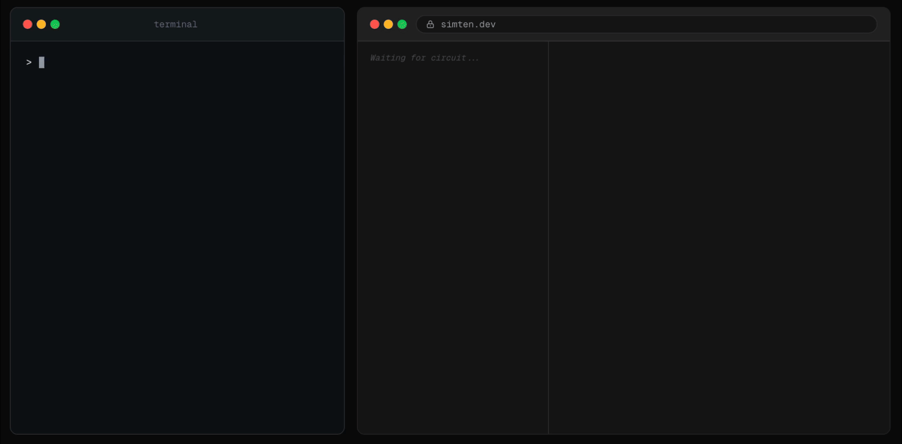

<div align="center">


# Simten

**Write hardware in TypeScript. Test it with npm. Run it on an FPGA.**

Write circuits as typed TypeScript, from a single NAND gate up to a RISC-V core.
Simulate them in the browser, export Verilog, run the result on an FPGA.

[**Live demo**](https://simten.dev) &nbsp;·&nbsp; [Play](https://play.simten.dev) &nbsp;·&nbsp; [Docs](https://simten.dev/docs) &nbsp;·&nbsp; [Blog](https://simten.dev/blog)

[](https://github.com/simtenHQ/simten/actions/workflows/ci.yml)
[](https://www.typescriptlang.org/)
[](https://developers.cloudflare.com/workers/)

</div>

## Why

Learning digital logic usually means choosing between visual simulators that stop
scaling after a few dozen gates, and Verilog, which needs a whole toolchain before it
shows you anything.

Simten circuits are TypeScript, so autocomplete, type errors on misnamed ports and
refactoring all just work, and you can test a circuit with any npm package. Every
component can be opened up on the canvas to show what it's made of.

## Try it

- [simten.dev/circuit](https://simten.dev/circuit) is the editor: type on the left, watch the circuit build itself on the right.
- [play.simten.dev](https://play.simten.dev) is a puzzle campaign that starts with a single NAND gate and ends with a 4-bit CPU built from everything you made along the way: gates, adders, latches, registers and an ALU.
- `pnpm add @simten/core` if you would rather start in your own project.

## Example

```typescript
import { circuit, bit } from '@simten/core/circuit'
import { Xor, And } from '@simten/core/std'

const HalfAdder = circuit('HalfAdder', {
  inputs: { a: bit, b: bit },
  outputs: { sum: bit, carry: bit },
  nodes: { xor1: Xor, and1: And },
  connect: ({ inputs, outputs, nodes: { xor1, and1 } }) => [
    inputs.a.to(xor1.a, and1.a),
    inputs.b.to(xor1.b, and1.b),
    xor1.out.to(outputs.sum),
    and1.out.to(outputs.carry),
  ],
})
```

- `inputs` / `outputs`: the circuit's pins, typed by width (`bit`, or `bus(8)` for 8 bits)
- `nodes`: the parts inside it
- `connect`: the wires, written `source.to(destination)`. It's typed from everything above,
  so pins autocomplete and a typo like `xor1.c` is a type error

To show it on a web page, render `<CircuitEmbed circuit={HalfAdder} />` from
`@simten/embed` in a React app. It draws the circuit with a clickable switch for each
input and a light for each output, so visitors can try it.

## AI assist (optional)

`@simten/mcp` is a local MCP server. Your agent writes circuits as files and calls
tools to check, simulate, verify and draw them, so the design lives in your repo
rather than in a chat log. `show_circuit` pushes to a browser tab over a local
WebSocket, which is why circuits appear and animate while the agent is still working.

```bash
claude mcp add --scope user simten npx @simten/mcp
```



The server runs on your machine, so nothing goes through Simten's servers, and it's
off unless you install it. When it runs a circuit's tests, they run on your machine
with the same access as `npm test`, so only use it on circuits you trust. For anything
else, use the web editor, which runs code in an isolated sandbox. See
[`packages/mcp/README.md`](packages/mcp/README.md).

## FPGA

Circuits export to Verilog, so they run on real hardware too. A RISC-V CPU running C
and Rust programs and an HDMI Snake both run on a ULX3S FPGA board today. Setup and
the build/flash workflow are in the [hardware docs](https://simten.dev/docs/hardware).

## Repo layout

```
packages/
├── core/        simulator, circuit() builder, stdlib, Verilog exporter
├── ui/          canvas, Monaco editor setup, shadcn primitives
├── embed/       <CircuitEmbed /> and a web-component build
└── mcp/         MCP server

apps/
├── web/         simten.dev (TanStack Start, Vite, Cloudflare Workers)
├── game/        play.simten.dev, the level campaign
├── embed-page/  embed.simten.dev, shared circuits for other sites' iframes
├── sandbox/     isolated origin where user circuit code executes
├── compiler/    RISC-V cross-compiler (GCC + Rust)
├── verifier/    Icarus Verilog, cross-checks exported Verilog against our trace
└── synth/       Yosys, returns gate counts and netlists

hardware/ulx3s/  FPGA projects and the build/flash/capture CLI
```

TanStack Start, React 19, React Flow, Zustand with Immer, Tailwind 4, Vitest,
deployed on Cloudflare Workers.

Simulation happens in the browser, so the edge stays stateless. The three container
services run on Cloudflare Containers behind Durable Objects and sleep after two
minutes idle. User circuit code never executes in the main frame: it runs in
`apps/sandbox`, on its own origin, under CSP.

## Running it locally

```bash
pnpm install
pnpm dev           # simten.dev on :3001
pnpm dev:sandbox   # second terminal, on :3002
pnpm dev:game      # play.simten.dev on :3003
pnpm dev:embed     # embed.simten.dev on :3004
pnpm test          # 1,000+ tests, plus the exports drift check
```

The sandbox is not optional. The canvas runs circuit code in an iframe pointed at
`localhost:3002` in dev and `sandbox.simtenusercontent.dev` in production, so without
`pnpm dev:sandbox` running alongside, nothing crashes and nothing draws either.

## Docs and contributing

- Rendered docs: [simten.dev/docs](https://simten.dev/docs). Markdown source in [`apps/web/content/docs/`](./apps/web/content/docs/).
- Blog posts working through real circuits: [simten.dev/blog](https://simten.dev/blog).
- [CONTRIBUTING.md](./CONTRIBUTING.md) covers setup tiers, code style and how publishing works.
- Bugs and features: [Issues](https://github.com/simtenHQ/simten/issues). Design questions: [Discussions](https://github.com/simtenHQ/simten/discussions). Security: [SECURITY.md](./SECURITY.md). Anything else: `hello@simten.dev`.

## License

[Apache 2.0](./LICENSE).
