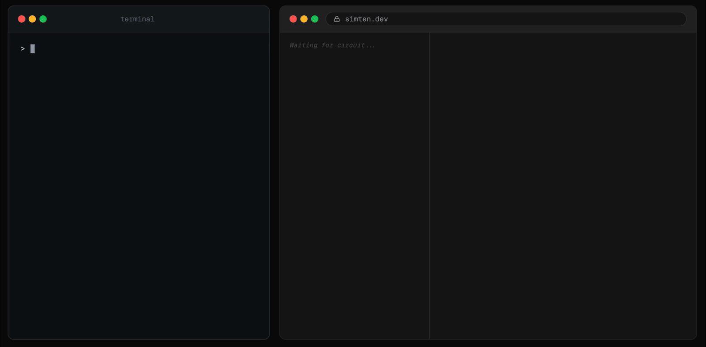

<div align="center">


# Simten

**Write hardware in TypeScript. Test it with npm. Run it on an FPGA.**

[**Editor**](https://simten.dev/circuit) &nbsp;·&nbsp; [Game](https://play.simten.dev) &nbsp;·&nbsp; [Docs](https://simten.dev/docs) &nbsp;·&nbsp; [Blog](https://simten.dev/blog)

[](https://github.com/simtenHQ/simten/actions/workflows/ci.yml)

</div>

Simten is a digital logic simulator where circuits are TypeScript. Ports are typed, so a
miswired circuit is a type error. Circuits run in the browser, in tests, and as Verilog
on an FPGA, from a single NAND gate up to a RISC-V CPU.

No install needed to try it:

- [simten.dev/circuit](https://simten.dev/circuit): type a circuit on the left, see it on the right.
- [play.simten.dev](https://play.simten.dev): a puzzle game that starts at one NAND gate and ends with a CPU.

## Hello world

**1. Write a circuit**

```bash
npm install @simten/core
```

```ts
import { bit, circuit } from '@simten/core'
import { And, Xor } from '@simten/core/std'

export const HalfAdder = circuit('HalfAdder', {
  inputs: { a: bit, b: bit },
  outputs: { sum: bit, carry: bit },
  nodes: { xor: Xor, and: And },
  connect: ({ inputs, outputs, nodes: { xor, and } }) => [
    inputs.a.to(xor.a, and.a),
    inputs.b.to(xor.b, and.b),
    xor.out.to(outputs.sum),
    and.out.to(outputs.carry),
  ],
})
```

`inputs` and `outputs` are the pins, `nodes` are the parts inside, and `connect` is the
wiring. A typo like `xor.c` doesn't compile.

**2. Run it**

```ts
import { simulate } from '@simten/core'

const sim = simulate(HalfAdder)
sim.set({ a: 1, b: 1 })
sim.read() // { sum: 0, carry: 1 }
```

**3. Show it in React**

```tsx
import '@simten/react/styles.css'
import { CircuitCanvas, useSimulation } from '@simten/react'

function Demo() {
  const sim = useSimulation(HalfAdder)
  return <CircuitCanvas simulation={sim} height={300} />
}
```

You get the circuit drawn with a switch on each input and a light on each output. Click
the switches to try it.

**4. Or put it on any page**

Open the circuit in the [editor](https://simten.dev/circuit) and use Share → Embed to get
an iframe.

**5. Build circuits with an AI assistant**

```bash
claude mcp add --scope user simten npx @simten/mcp
```

Your assistant writes circuits as files in your repo, tests them, and draws them in a
browser tab. Works with any MCP client.



## FPGA

Circuits export to Verilog. A RISC-V CPU running C and Rust, and Snake over HDMI, both
run on a ULX3S board. See the [hardware docs](https://simten.dev/docs/hardware).

## Packages

| Package | Use it to |
|---|---|
| [`@simten/core`](packages/core) | Write and simulate circuits, export Verilog |
| [`@simten/react`](packages/react) | Show circuits in a React app |
| [`@simten/sandbox`](packages/sandbox) | Run circuits from any web page, without React |
| [`@simten/mcp`](packages/mcp) | Let an AI assistant build circuits |

## Working on Simten

```bash
pnpm install
pnpm dev           # simten.dev on :3001
pnpm dev:sandbox   # the sandbox on :3002, needed for anything to draw
pnpm dev:game      # play.simten.dev on :3003
pnpm test
```

Circuit code never runs on the page. It runs in a sandbox on its own domain, which is
why `dev:sandbox` has to be running. [CONTRIBUTING.md](CONTRIBUTING.md) covers the rest.

Bugs and ideas go in [Issues](https://github.com/simtenHQ/simten/issues), and security
reports to [SECURITY.md](SECURITY.md).

## License

[Apache 2.0](LICENSE)
